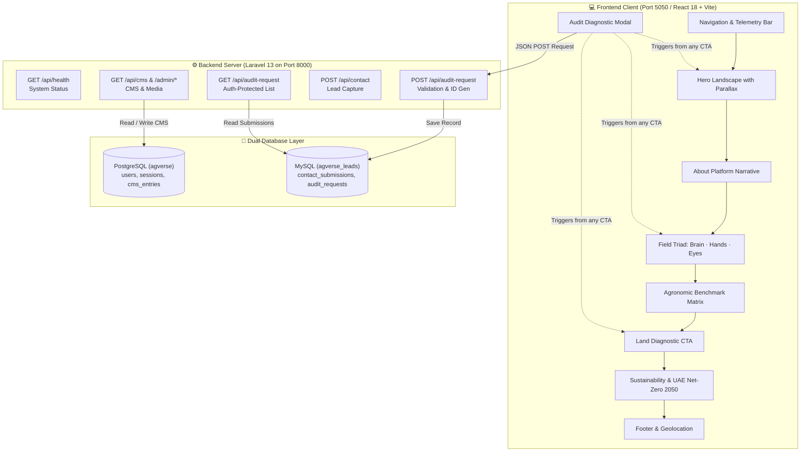

<div align="center">

# 🌿 AGVERSE — Ecosystem & Technical Architecture

**The Intelligence of the Earth | Global Food Producing Operating System**  
*A modern, humanized full-stack web application built with React 18, Tailwind CSS, and Laravel 13 (PostgreSQL + MySQL).*

[](#)
[](#)
[](#)
[](#)

<p align="center">
  <a href="http://localhost:5050"><b>🌐 Live Preview (Port 5050)</b></a> •
  <a href="#-system-architecture"><b>🏗️ Architecture</b></a> •
  <a href="#-interactive-components"><b>🧩 Components</b></a> •
  <a href="#-api-specifications"><b>📡 REST API</b></a> •
  <a href="#-quick-start"><b>🚀 Run Instructions</b></a>
</p>

---

</div>

## 📌 Executive Summary

**AGVERSE** is an agricultural operating platform that integrates artificial intelligence, robotics, multispectral drone fleets, and real-time soil telemetry to build the world’s most efficient, compliant, zero-waste food production ecosystem.

This application is an end-to-end full-stack recreation of **[agverse.ae](https://agverse.ae/)**, redesigned with **Impeccable craft guidelines** to eliminate generic AI design tropes and deliver an authentic, humanized, and grounded agronomic experience.

---

## 🏗️ System Architecture



---

## 🎨 Visual Identity & Design Tokens

Designed around **Arid Mineral & Nocturnal Oasis** aesthetics — rejecting bright generic purple gradients in favor of earthy loam, illuminated desert teal, and bio-chlorophyll green.

### 🎨 Color Palette

| Swatch | Token | Hex Code | Visual Meaning |
|---|---|---|---|
|  | `--ag-dark` | `#021312` | Deep root night ground |
|  | `--ag-dark-loam` | `#06201D` | Rich loam card and panel surface |
|  | `--ag-dark-surface` | `#0B2D29` | Elevated controls and focused containers |
|  | `--ag-teal` | `#ACD5D1` | Signature oasis brand color & metric numerals |
|  | `--ag-chlorophyll` | `#2CC56F` | Biological telemetry, Net-Zero indicators |
|  | `--ag-wheat` | `#E4D5BE` | Warm harvest grain accent |
|  | `--ag-muted` | `#96B1AC` | Tinted technical copy (contrast $\ge 4.5:1$) |

### 🖋️ Typography System

```
Display Headings:   Marcellus (Organic Architectural Serif)
Body & Telemetry:   Manrope (Humanized Precision Engineering Sans)
Body Text Measure:  65ch – 75ch for optimal reading comfort
Letter Tracking:    -0.03em on bold titles, +0.08em on uppercase mono specs
```

---

## 🧩 Interactive Components Catalog

### 1. Navigation Header (`Navbar.jsx`)
- **Brand Identity**: Original SVG logos (`Asset-1.svg` / `Asset-3.svg`).
- **Live Node Telemetry**: Real-time status indicator (`Dubai HQ · MENA Agritech Grid Active`).
- **Smooth Navigation**: Anchor scroll to `#about`, `#technology`, `#sustainability`.
- **Primary CTA**: Fast-path "Request Tech Audit" trigger with responsive mobile drawer.

### 2. Panoramic Hero (`Hero.jsx`)
- **3D Mouse Parallax**: Fluid mathematical tracking reacting to cursor coordinates over `banner-img.jpeg`.
- **Editorial Headline**: *"The Intelligence of the Earth"* without generic badge pills.
- **Interactive Telemetry Deck**:
  - Subsurface Irrigation Telemetry (99.4% evaporation reduction)
  - Multispectral Canopy Scan (3,840 ha mapped with drone fleet)
  - Neural Soil Optimization (10x crop simulation cycle acceleration)

### 3. Living Field Narrative (`About.jsx`)
- **Ecosystem Comparison**: Contrasting fragmented industrial agriculture against the AGverse mega-platform.
- **Three Grounded Pillars**:
  1. *Precision Farming* — Single-seed telemetry and sub-drop hydration.
  2. *Data-Driven Decisions* — Predictive AI yield forecasting before sprouting.
  3. *Maximum Efficiency* — Scaling crop turnaround at 10x speed.
- **Physical Instrument Counter**: Viewport intersection observer animating smoothly from $0 \rightarrow 10$ with suffix `x`.

### 4. Autonomous Field Triad (`Technology.jsx`)
- **Master-Detail Engineering Console**: Interactive switcher across three core systems:
  - 🧠 **The Brain** (`AI-brain.jpeg`): Multi-layer agronomic neural networks.
  - 🤖 **The Hands** (`AI-brain-2.jpeg`): Bifacial solar autonomous robotics with millimeter RTK-GNSS precision.
  - 🛰️ **The Eyes** (`AI-brain-3.jpeg`): 5-band multispectral and thermal drone squadrons.

### 5. Agronomic Benchmark Matrix (`Statistics.jsx`)
- Contextual proof metrics with deep color calibration:
  - `10x` — Virtual climate simulation replacing multi-year field trials.
  - `ZERO` — Subsurface closed-loop irrigation preventing water runoff.
  - `24/7` — Diurnal and nocturnal automated field operations.
  - `NET-ZERO` — Decarbonization pathway aligned with UAE Net Zero 2050.

### 6. Land Diagnostic Call to Action (`CallToAction.jsx`)
- Panoramic landscape (`Guess.jpeg`) highlighting agricultural certainty.
- Transparent technical guarantees: Complimentary land assessment and direct site inspection by UAE agronomists.

### 7. Sustainability & Closed-Loop Commitment (`Sustainability.jsx`)
- Eco-resilience manifesto over `secrtion-2.jpeg`.
- Concrete environmental targets: -65% carbon logistics, up to 90% water conservation, and arid desert climate calibration.

### 8. Farm Tech Evaluation Studio (`AuditModal.jsx`)
- Interactive diagnostic modal dialog with real-time validation.
- Submits farm data to backend API and delivers an immediate reference code (`#AGV-XXXXXX`) with celebratory confetti.

---

## 📡 REST API Specifications

The Laravel 13 backend (`127.0.0.1:8000`) serves all REST API endpoints, CMS APIs, and admin routes, proxied through Vite on **port 5050** in development.

### 1. Health Check
```http
GET /api/health
```
**Response (200 OK):**
```json
{
  "status": "ok",
  "service": "AGverse Laravel API",
  "time": "2026-11-26T10:30:00+00:00"
}
```

---

### 2. Submit Farm Tech Audit Request
```http
POST /api/audit-request
Content-Type: application/json
```
**Request Payload:**
```json
{
  "fullName": "Tariq Al-Mansoor",
  "email": "tariq@agrifarm.ae",
  "phone": "+971 50 123 4567",
  "farmName": "Al-Dhafra Agri Holdings",
  "location": "Abu Dhabi, UAE",
  "farmSize": "100-500 Hectares",
  "interest": "Autonomous Robotics",
  "notes": "Testing automated subsurface irrigation for date palm groves."
}
```
**Response (201 Created):**
```json
{
  "success": true,
  "message": "Farm technology audit request submitted successfully.",
  "referenceId": "AGV-849201",
  "data": {
    "id": "1794640192834",
    "referenceId": "AGV-849201",
    "fullName": "Tariq Al-Mansoor",
    "email": "tariq@agrifarm.ae",
    "phone": "+971 50 123 4567",
    "farmName": "Al-Dhafra Agri Holdings",
    "location": "Abu Dhabi, UAE",
    "farmSize": "100-500 Hectares",
    "interest": "Autonomous Robotics",
    "notes": "Testing automated subsurface irrigation for date palm groves.",
    "status": "pending",
    "createdAt": "2026-11-14T07:15:32.100Z"
  }
}
```

---

### 3. Retrieve All Submitted Audits
```http
GET /api/audit-request
```
**Response (200 OK):**
```json
{
  "success": true,
  "count": 2,
  "data": [
    {
      "id": "1794640192834",
      "referenceId": "AGV-849201",
      "fullName": "Tariq Al-Mansoor",
      "farmName": "Al-Dhafra Agri Holdings",
      "status": "pending",
      "createdAt": "2026-11-14T07:15:32.100Z"
    }
  ]
}
```

---

### 4. Dynamic Platform Content
```http
GET /api/content
```
**Response (200 OK):**
```json
{
  "brand": "AGVERSE",
  "tagline": "The Intelligence of the Earth",
  "location": "Dubai, UAE",
  "statistics": {
    "cropSimulationSpeed": "10x",
    "wasteIrrigation": "ZERO",
    "monitoring": "24/7",
    "carbonGoal": "NET-ZERO by 2030"
  }
}
```

---

## 🗂️ File Directory Hierarchy

```
agverse/
│
├── 📂 client/                          # React 18 Frontend
│   ├── 📂 public/assets/               # Downloaded authentic banners & SVGs
│   │   ├── Asset-1.svg                 # Brand teal logo
│   │   ├── Asset-3.svg                 # White monochrome logo
│   │   ├── banner-img.jpeg             # Hero terrain background
│   │   ├── about-img.jpeg              # About section background
│   │   ├── AI-brain.jpeg               # AI & Neural Net showcase
│   │   ├── AI-brain-2.jpeg             # Autonomous robotics showcase
│   │   ├── AI-brain-3.jpeg             # Multispectral drone fleet showcase
│   │   ├── Guess.jpeg                  # Call to action background
│   │   └── secrtion-2.jpeg             # Sustainability background
│   │
│   ├── 📂 src/
│   │   ├── 📂 components/
│   │   │   ├── Navbar.jsx              # Sticky header with telemetry indicator
│   │   │   ├── Hero.jsx                # Parallax hero with live telemetry deck
│   │   │   ├── About.jsx               # Narrative & animated 10x counter
│   │   │   ├── Technology.jsx          # Master-detail Field Triad (Brain, Hands, Eyes)
│   │   │   ├── Statistics.jsx          # Contextual Agronomic Matrix
│   │   │   ├── CallToAction.jsx        # Land diagnostic invitation
│   │   │   ├── Sustainability.jsx      # UAE Net-Zero 2050 manifesto
│   │   │   ├── Footer.jsx              # Architectural footer with UAE coordinates
│   │   │   └── AuditModal.jsx          # Interactive evaluation form with validation
│   │   ├── 📂 data/
│   │   │   └── siteContent.js          # Centralized data model
│   │   ├── App.jsx                     # Root application assembler
│   │   ├── index.css                   # Impeccable craft rules & scrollbars
│   │   └── main.jsx                    # React DOM entry
│   │
│   ├── index.html                      # Google Fonts (Marcellus + Manrope)
│   ├── tailwind.config.js              # Custom color palette and font definitions
│   ├── vite.config.js                  # Vite server & API proxy on port 5050
│   └── package.json                    # Client dependencies
│
├── 📂 backend/                         # Laravel 13 Backend & CMS
│   ├── 📂 app/Http/Controllers/        # CmsController & Api/* controllers
│   ├── 📂 app/Models/                  # User, CmsEntry, ContactSubmission, AuditRequest
│   ├── 📂 database/migrations/         # PostgreSQL & MySQL schema migrations
│   ├── 📂 routes/                      # web.php (CMS/Admin) & api.php (REST API)
│   └── composer.json                   # PHP / Laravel dependencies
│
├── dev.js                              # Concurrent development orchestrator
├── package.json                        # Root project scripts
├── DESIGN.md                           # Impeccable design system manual
├── DOCUMENTATION.md                    # Master technical & architectural guide
└── README.md                           # Quick-start manual
```

---

## 🚀 Quick Start Guide

### 1. Installation
Clone the project and install all dependencies:

```bash
# In the project root (d:\Alif\OWN\agverse)
npm run install:all
```

### 2. Running on Port 5050

```bash
# Development mode (Vite HMR on port 5050 proxying to Laravel on 8000)
npm run dev

# Run Laravel backend directly
npm start
```

### 3. Quality & Design Verification
Run the Impeccable design detector to verify zero anti-patterns:

```bash
npm run lint:design
# or
npx impeccable detect client/src
```

Output:
```
13 files scanned.
0 anti-patterns found. Clean bill of health.
```

---

<div align="center">

**AGVERSE** — Built with precision for sustainable agricultural transformation.  
*Dubai, United Arab Emirates • © 2026 AGverse. All Rights Reserved.*

</div>
